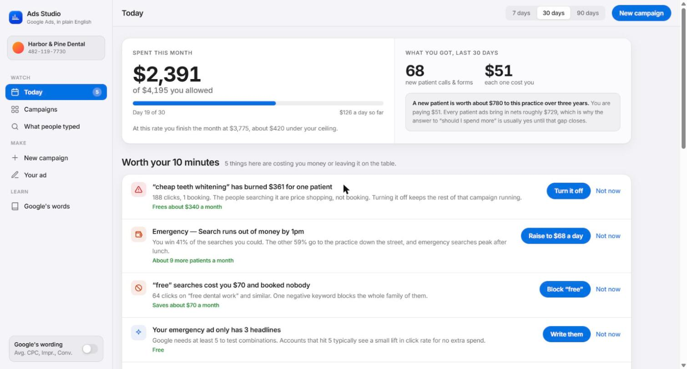
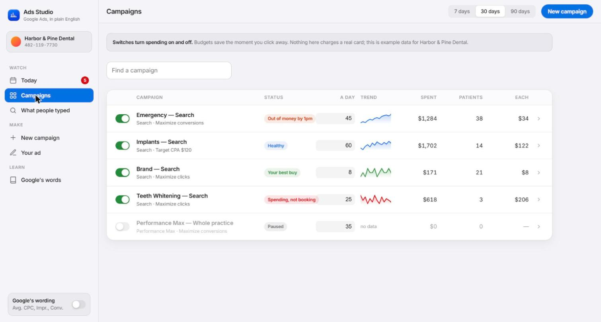
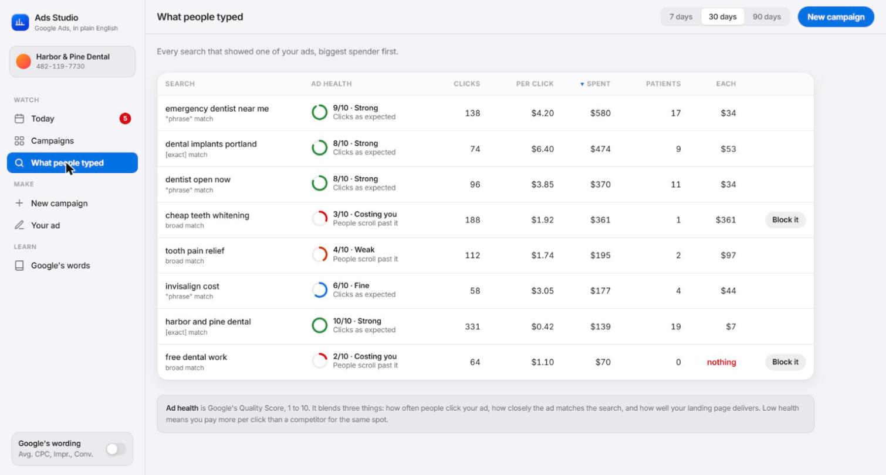
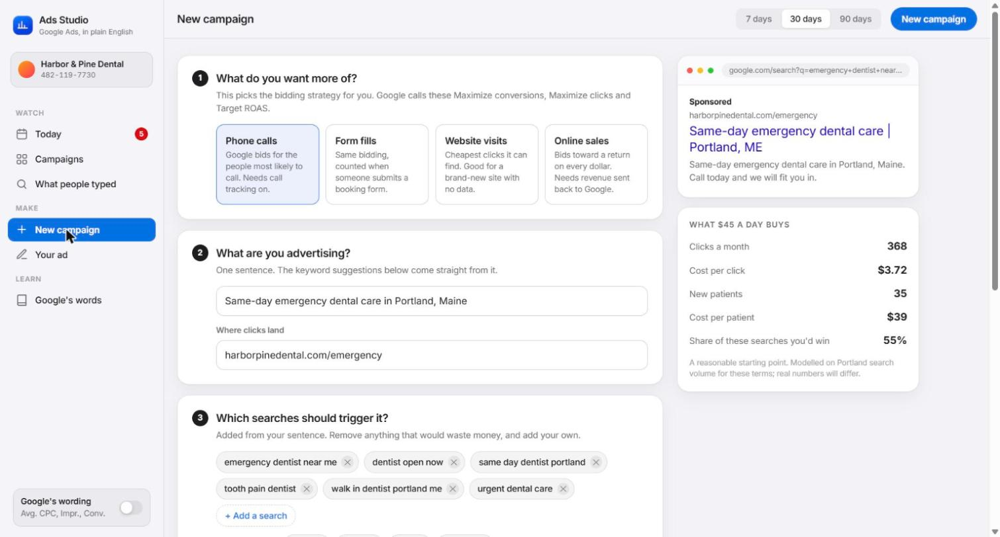
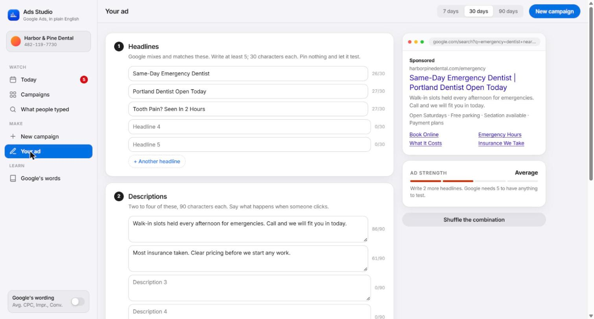
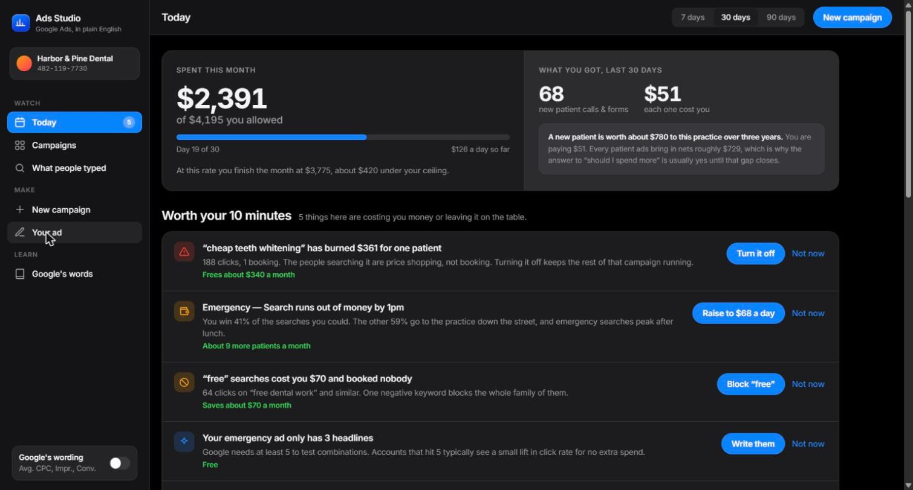
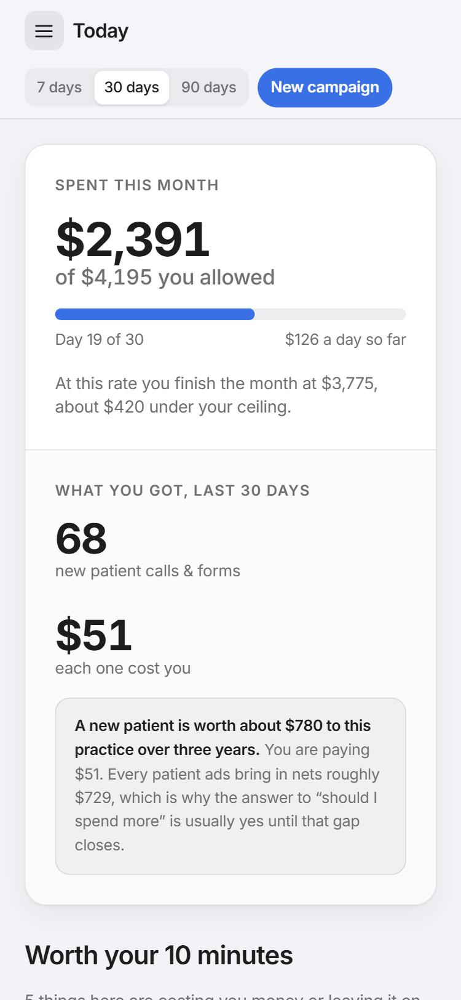

# Ads Studio

A Google Ads console rebuilt in plain English and Apple's design language. It
answers the one question the real interface buries, which is what a booked
customer costs, and it says it in the words the person paying the bill would use.



## What this repository is

Baseline architecture. The derived-metrics model, the plain-English layer, the
recommendation engine and the view structure here are the foundation that much
larger client software gets built on top of. What is in this repository is the
layer that does not change from one build to the next.

A client build keeps this core and adds what that account needs: a real Google
Ads API connection behind the data, OAuth and account selection, write-back for
budget and status changes, conversion imports from the phone system or the
booking form, and scheduled reporting. The way the numbers are derived and
explained stays as it is, because that part is the product.

Read it as a structural reference, not as a product.

## Why it exists

Google Ads shows a small business owner roughly forty numbers and hides the one
that decides whether to keep spending. Impressions, click-through rate, average
position, Quality Score, conversion rate, cost per click: all real, none of them
the answer to "is this working".

The answer is cost per booked customer set against what a customer is worth. Two
numbers. The interface can produce both and does not lead with either, because it
was built for people who run ads for a living and is used by people who run a
dental practice.

Ads Studio leads with them. The spend figure is paired with what the spend bought,
every recommendation is priced in dollars a month rather than scored out of ten,
and a sidebar switch flips the whole application between plain English and
Google's own vocabulary so the two can be learned against each other.

## The six views



| View | What it does |
| --- | --- |
| Today | Month-to-date pacing, a prioritised fix list, four KPIs, a day-by-day chart |
| Campaigns | Inline budget editing, on and off switches, search, a detail panel |
| What people typed | The search terms report, sortable, with Quality Score renamed "Ad health" |
| New campaign | A five-question builder with a live search-result preview and a forecast |
| Your ad | Responsive search ad editor with character counts, Ad Strength, sitelinks and callouts |
| Google's words | The jargon-to-plain-English glossary |

The search terms report is the one worth opening first. It is where the waste is
visible: a term with 188 clicks and one booking sits next to one with 331 clicks
at 42 cents, and the column that matters is the rightmost.



The campaign builder asks five questions in order and shows the ad and the
forecast updating beside them, so the budget slider and the share of searches you
would win move together.



The ad editor enforces Google's real limits, 30 characters a headline and 90 a
description, and scores Ad Strength the way Google does, which is mostly a count
of how many distinct headlines it has to test with.



## Architecture

One HTML file. No build step, no package manager, no framework, no CDN script and
no network call. The entire application is `index.html`: design tokens, component
CSS, markup for six views, then the script.

### Everything on Today derives from one series

`buildSeries()` is the single source of truth. It generates twice the selected
window, so the first half is the previous period and the second half is what is on
screen. The chart bars, every sparkline, each KPI value and every percentage delta
read off those same buckets.

This is why no figure in the app can disagree with another one. There are no
hardcoded deltas anywhere, and reintroducing one would be the way to break it.

### Plain English and Google's words

Every label exists in both vocabularies, either as paired `data-plain` and
`data-jargon` attributes or through the `W(plain, jargon)` helper. The sidebar
switch flips all of them at once and the choice persists.

A new label needs both halves. That constraint is the feature: it forces a
decision about what a thing is actually called, rather than letting Google's name
for it leak through by default.

### Recommendations are priced, not scored

The fix list on Today carries a dollar figure per item, "Frees about $340 a month"
rather than a severity badge. Each one states the finding, the reason, the money,
and a single button that performs it.

### Undo rather than confirm

Destructive actions snapshot the whole mutable state as JSON and pass a restore
closure to the toast. The state is small enough that this is cheaper than writing
an inverse for every action, and it means nothing in the app interrupts you to ask
whether you meant it.

### Dark mode and small screens



The dark theme is declared three ways: on bare `:root`, under
`prefers-color-scheme`, and under an explicit `[data-theme]`. All three exist so
the app is correct whether the viewer chose a theme or left it on system.

Responsive rules sit at 1150, 1120, 900, 760, 620 and 440 pixels. The campaign
table drops columns rather than scrolling the page, and the sidebar becomes a
drawer.



## Running it

Serve it over HTTP rather than opening the file directly:

```bash
python3 -m http.server 8000
```

Then open <http://localhost:8000>.

`file://` renders fine but browsers treat it as an opaque origin, so
`localStorage` throws and the app silently stops remembering your date range,
wording preference and dismissed recommendations. The storage calls are wrapped in
try/catch, so nothing breaks visibly, which is exactly why it is worth knowing.

## Honest status

This is a working build, not a shipped product. The gaps below are the ones a
client build closes.

- **It does not connect to Google Ads.** There is no API client, no OAuth and no
  account linking anywhere in this repository. Every figure is generated locally.
  This is a console design over modelled data, not a client for Google's API.
- **The data is fictional.** Harbor & Pine Dental does not exist, the domain in
  the previews does not resolve, and the account number is invented. No real
  advertiser, spend figure or client of any kind is in this repository.
- **The forecast is a model, not Keyword Planner.** The campaign builder's
  projected clicks, cost per click and share of searches are plausible arithmetic
  on the budget and the goal. They are not a query against Google's volume data
  and they will not match it.
- **Campaign and keyword edits are in-memory.** Only the date range, the wording
  preference and dismissed recommendations persist. A reload resets the rest, by
  design.
- **No tests.** Verification has been done by driving the page in a browser and
  asserting against the DOM. The checks worth repeating after a change are listed
  in `CLAUDE.md`.
- **Ad Strength is an approximation.** It counts distinct headlines and
  descriptions the way Google broadly does, without Google's model behind it.

## Origin

Built with Claude Code, and first published as a Claude artifact. The file in this
repository carries its own document head: the artifact host supplied the doctype,
charset and viewport, so the extracted copy needed them added before it would
render correctly when served normally.

## Licence

No licence is granted. This repository is published so the architecture can be
read, not reused.
